# Java Notes

Personal Java notes, from the very basics to the Collection Framework, with examples and diagrams.

## Table of Contents

1. [Basics](#basics)
2. [Data Types](#data-types)
3. [String](#string)
4. [Operators](#operators)
5. [Conditional Statements](#conditional-statements)
6. [Loops](#loops)
7. [Arrays](#arrays)
8. [OOPs](#oops)
9. [Multithreading Basics](#multithreading-basics)
10. [Time](#time)
11. [Try-Catch Block](#try-catch-block)
12. [Collection Framework](#collection-framework)

---

## Basics

Java is an object-oriented programming language (not pure OOPs).

**Why not pure OOPs?**

Contradiction: `int` is not a class, it's a `datatype`. That's why Java is not pure OOPs.

All code in Java lives inside classes.

Philosophy - *"write once, run anywhere"*, i.e., system independent using JVM.

**To start with Java ->** you need the JDK (Java Development Kit).

JDK contains: development tools (`javac`, `javadoc`), source code and JRE (Java Runtime Environment).

JRE contains compiled core classes + config files (to tell Java how to run) + JVM (Java Virtual Machine).

JVM is the actual engine that runs Java bytecode on any platform.

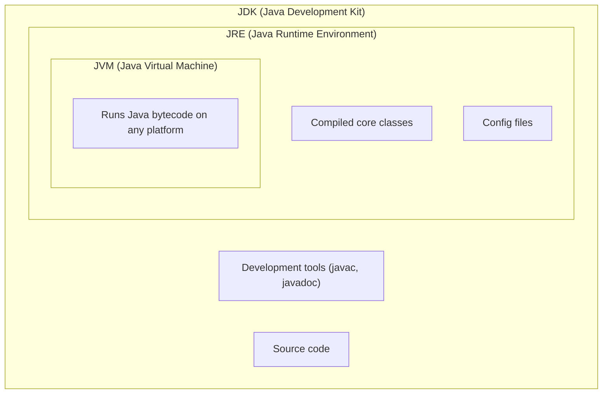

**So basically**, developers use JDK to create Java apps, while end users only need JRE to run Java apps.

### Flow

`source code (.java)` -> `compilation (javac)` -> `.class (bytecode, platform independent)` -> `JVM` -> `machine code (platform dependent)`

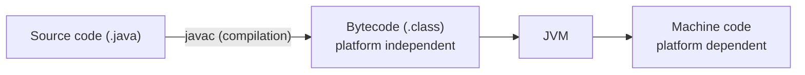

### Syntax

```java
public class Test {
    public static void main(String[] args) {
        System.out.println("Hello, World!");
    }
}
```

### Class and Object

A class is the blueprint (ex: home design) while an instance (object) is the actual thing created (ex: home). One class can have multiple instances.

To create an instance:

```java
// creating a new Test object (actual thing from blueprint)
Test n = new Test();
```

> [!IMPORTANT]
> Very important: objects (instances) go into heap memory, while local primitive variables go into stack memory.
> A reference variable (like `n`) lives on the stack and points to its object on the heap. Primitive fields of an object live inside that object, on the heap.

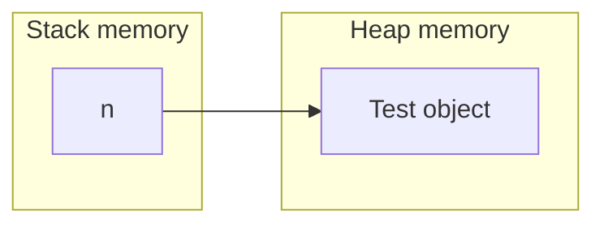

### Method Signature

Now, signature: `public static void main(String[] args)`

| Part | Meaning |
|------|---------|
| `public` | Access modifier, indicating this method can be accessed from outside the class. |
| `static` | Belongs to the class, not to the instance. |
| `void` | Returns nothing. |
| `main` | Entry point. |
| `String[] args` | Accepts an array of strings as parameters (you can give it using the command line). |

### Breaking Down `System.out.println`

| Part | Meaning |
|------|---------|
| `System` | A class that provides access to the system, including the console. |
| `out` | An instance of the `PrintStream` class within the `System` class, representing the console. |
| `println` | Method used to print (here, we're printing on the console). |
| `;` (semicolon) | Denotes the end of the statement to the compiler. |

> [!NOTE]
> In Java, the file name and the `public` class name must be the same (a file can have at most one public top-level class).

---

## Data Types

| Category | Type | Size (bytes) |
|----------|------|--------------|
| Integer | `long` | 8 |
| Integer | `int` | 4 |
| Integer | `short` | 2 |
| Integer | `byte` | 1 |
| Decimal | `double` | 8 |
| Decimal | `float` | 4 |
| True/False | `boolean` | 1 (JVM-dependent) |
| Characters | `char` | 2 |

Remember: 1 byte = 8 bits (2^8 = 256 possible combinations of 0/1).

To check min/max value: `Integer.MIN_VALUE`

Note: `Integer` is a class, `int` is a data type.

> [!IMPORTANT]
> Very important: in Java, integer literals are by default `int`, while decimals are `double`.
> So add a *suffix* to tell the compiler:

```java
float c = 10.5f;     // float (f suffix required) or F
long d = 100L;       // long (L suffix)
```

Also,

- `double`: precision limit is up to ~`15-16 significant digits`
- `float`: precision limit is up to ~`6-7 significant digits`

Ex: 123.45 has 5 significant digits.

> [!NOTE]
> Use single quotes for `char` (`'a'`) and double quotes for strings (`"abc"`).

### Conversion

1. Implicit (widening conversion): to put small into large (int -> long). This happens automatically, no cast needed.
2. Explicit (narrowing conversion): to put large into small (double -> float). This is done using typecasting. Data loss can happen.

Example:

```java
double n = 10.8323;
float y = (float) n;
```

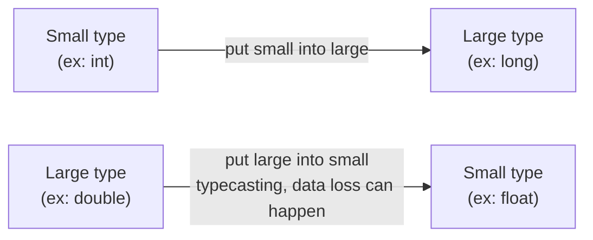

---

## String

In Java, `String` is a class (a reference type), not a primitive data type.

Example:

```java
String s1 = "Hello"; // direct literal
String s2 = "Hello";
String s3 = new String("Hello"); // using constructor
```

Above we learnt,

- objects go into the heap.
- local primitive variables go into the stack.

So when we type: `String s1 = "Hello";`
here `s1` points to the *memory address* where `Hello` is stored.

While in: `int a = 1;`
`a` holds the *data*, not the memory address.

### String Pooling

In the heap, there is a *String pool*,
so when `s1 = "Hello"` and `s2 = "Hello"`, then `s2` also points to the same `"Hello"` to save memory.

So when we do,

```java
String s1 = "Hello";
String s2 = "Hello";
String s3 = new String("Hello");

s1 == s2 // true (same reference in pool)
s1 == s3 // false (different objects)
s1.equals(s3) // true, same content
```

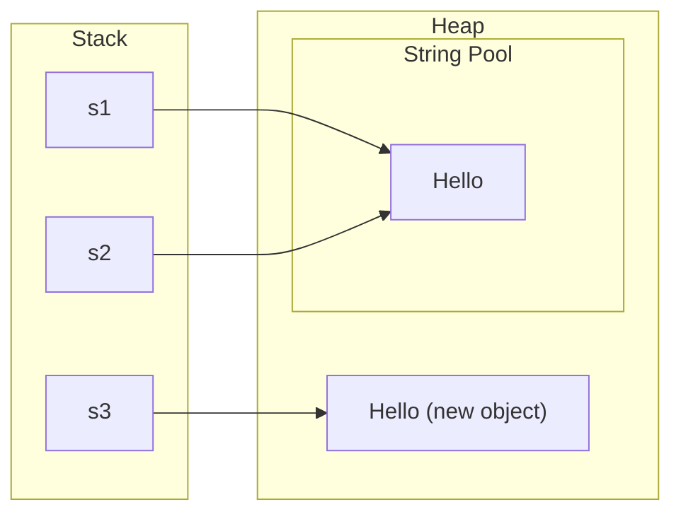

### String Immutability

Strings are immutable (cannot be modified after creation).
As we know, the String Pool reuses identical String literals to save memory.
So String *Immutability* prevents changes to a shared String object, which could otherwise affect all references pointing to it.

```java
String s1 = "Hello";
String s2 = "Hello";
String s3 = s1.toUpperCase();

s1 = "Ram"; // s1 points to a new object; "Hello" remains unchanged.
s3 // 'HELLO', here also new object created
```

### Common String Operations

```java
public class StringMethods {
    public static void main(String[] args) {

        String text = "Hello World";

        // 1. length() – returns total number of characters.
        System.out.println(text.length());              // 11

        // 2. charAt() – accesses character at a given index.
        System.out.println(text.charAt(0));             // H

        // 3. substring() – extracts a portion of a string (end exclusive).
        System.out.println(text.substring(0, 5));       // Hello

        // 4. contains() – checks whether string contains given text.
        System.out.println(text.contains("World"));    // true

        // 5. indexOf() – returns first occurrence index.
        System.out.println(text.indexOf("o"));         // 4

        // 6. lastIndexOf() – returns last occurrence index.
        System.out.println(text.lastIndexOf("o"));     // 7

        // 7. replace() – replaces characters or text.
        System.out.println(text.replace("World", "Java")); // Hello Java

        // 8. toLowerCase() – converts string to lowercase.
        System.out.println(text.toLowerCase());         // hello world

        // 9. toUpperCase() – converts string to uppercase.
        System.out.println(text.toUpperCase());         // HELLO WORLD

        // 10. trim() – removes leading and trailing whitespace.
        System.out.println("  Java  ".trim());          // Java

        // 11. isEmpty() – checks whether string length is zero.
        System.out.println("".isEmpty());               // true

        // 12. equals() – compares string content (case-sensitive).
        System.out.println("Java".equals("Java"));      // true

        // 13. equalsIgnoreCase() – compares without case sensitivity.
        System.out.println("Java".equalsIgnoreCase("java")); // true

        // 14. compareTo() – compares strings lexicographically.
        System.out.println("Apple".compareTo("Banana")); // Negative value

        // 15. split() – splits string using a delimiter.
        String[] words = "Java Python C++".split(" ");
        System.out.println(words[0]);                   // Java

        // 16. toCharArray() – converts string into character array.
        char[] chars = text.toCharArray();
        System.out.println(chars[0]);                   // H

        // 17. String.valueOf() – converts other data types into String.
        System.out.println(String.valueOf(100));        // 100

        // 18. StringBuilder – efficient string modification.
        StringBuilder sb = new StringBuilder("Hello");
        sb.append(" Java");
        System.out.println(sb);                         // Hello Java
    }
}
```

---

## Operators

### Arithmetic

- Operations: `+ - * / %`
- Shortcuts: `+= -= *= /= %=`

Example:

```java
// int / int = int division; result 3 converted to float → 3.0
float d1 = 10 / 3; 

// double / int = double division; result is double, cannot be assigned to float without explicit casting (COMPILATION ERROR).
float d = 10.0 / 3;

// double / int = double division; cast double result to float → 3.3333333
float d2 = (float) (10.0 / 3);

// int / float = float division; result → 3.3333333
float d3 = 10 / 3.0f;
```

#### Increment / Decrement

`a++` (post inc), `++a` (pre inc), `a--` (post dec), `--a` (pre dec)

Example:

```java
// post (i++): first use current value, then increment
// pre (++i): first increment, then use updated value
public class Increment {
    public static void main(String[] args) {

        // Example 1: Post-increment
        int a = 5;
        int b = a++;
        System.out.println(b); // 5 (old value used first)
        System.out.println(a); // 6 (then incremented)


        // Example 2: Pre-increment
        int x = 5;
        int y = ++x;
        System.out.println(y); // 6 (incremented first)
        System.out.println(x); // 6


        // Example 3: Post vs Pre in expressions
        int p = 5;
        int q = 5;

        System.out.println(p++); // 5 (prints first, then increments)
        System.out.println(++q); // 6 (increments first, then prints)
    }
}
```

### Bitwise

To play with binary numbers.

`& (and) | (or) ^ (xor) ~ (not) << (left shift) >> (right shift)`

Example:

```java
int a = 2;
System.out.println(Integer.toBinaryString(a)); // 10 -> binary code
```

| Operator | Name | Description |
|----------|------|-------------|
| `&` | AND | Both bits must be 1 to return 1. |
| `\|` | OR | At least one bit must be 1 to return 1. |
| `^` | XOR | Both bits must be different to return 1. |
| `~` | NOT | Inverts every bit (0 becomes 1 and 1 becomes 0). |
| `<<` | LEFT SHIFT | Shifts bits to the left by specified positions; fills rightmost bits with 0. |
| `>>` | RIGHT SHIFT | Shifts bits to the right; preserves the sign bit. |
| `>>>` | UNSIGNED RIGHT SHIFT | Shifts bits to the right; fills leftmost bits with 0. |

### Relational

Return a boolean result.

`< > <= >= == !=`

### Logical

Used to combine two or more conditions/boolean expressions.

`&& (and) || (or) ! (not)`

---

## Conditional Statements

### 1. Simple `if` statement

```java
if (condition) {
    // Executes if condition is true
}
```

### 2. `if-else` statement

```java
if (condition) {
    // Executes if condition is true
} else {
    // Executes if condition is false
}
```

### 3. `if-else-if` ladder

```java
if (condition1) {
    // Executes if condition1 is true
} else if (condition2) {
    // Executes if condition2 is true
} else if (condition3) {
    // Executes if condition3 is true
} else {
    // Executes if all conditions are false
}
```

### 4. Nested `if` statement

```java
if (condition1) {
    // Executes if condition1 is true

    if (condition2) {
        // Executes if both conditions are true
    }
}
```

### 5. `switch` statement

```java
// break is important because once a case matches, execution continues
// into all subsequent cases until break or the end of the switch.
switch (variable) {
    case value1:
        // Executes if variable == value1
        break;

    case value2:
        // Executes if variable == value2
        break;

    default:
        // Executes if no case matches
}
```

### 6. Ternary operator (conditional expression)

```java
result = (condition) ? value_if_true : value_if_false;
// Returns one of two values based on the condition
```

---

## Loops

### 1. `for` loop

```java
for (initialization; condition; update) {
    // Executes repeatedly while condition is true
}
```

### 2. `while` loop

```java
while (condition) {
    // Checks condition before each iteration
}
```

### 3. `do-while` loop

```java
do {
    // Executes at least once before checking condition
} while (condition);
```

### 4. Nested `for` loop

```java
for (initialization; condition; update) {
    // Outer loop

    for (initialization; condition; update) {
        // Inner loop
    }
}
```

### 5. Enhanced `for` loop (for-each)

```java
for (dataType variable : arrayOrCollection) {
    // Iterates through each element
}
```

### Loop Control Statements

```java
// 1. break
break;       // Terminates the loop immediately

// 2. continue
continue;    // Skips current iteration and moves to the next

// 3. return
return;      // Exits the current method
```

---

## Arrays

A data structure (DS) that stores elements of the same type (contiguous).

Example:

```java
// 1. Declaration (recommended)
int[] numbers;

// 2. Declaration (less common, but valid)
int numbers[];

// 3. Array creation with size (default values are 0)
int[] numbers = new int[5]; // {0, 0, 0, 0, 0}

// Default values of Java array elements:
// 1. int     -> 0
// 2. float   -> 0.0f
// 3. double  -> 0.0
// 4. boolean -> false
// 5. char    -> '\u0000'
// 6. Object  -> null
// 7. String  -> null

// 4. Declaration + initialization with values
int[] arr = {10, 20, 30, 40, 50};

// 5. Using new with explicit values
int[] arr2 = new int[]{10, 20, 30};

// 6. Accessing elements (index starts from 0)
System.out.println(numbers[0]); // 0

// 7. Updating an element
numbers[0] = 100;

// 8. Finding array length
System.out.println(numbers.length); // 5
```

| Element type | Default value |
|--------------|---------------|
| `int` | `0` |
| `float` | `0.0f` |
| `double` | `0.0` |
| `boolean` | `false` |
| `char` | `'\u0000'` |
| `Object` | `null` |
| `String` | `null` |

> [!NOTE]
> Printing an array directly (`println(a)`) does not show its elements; it prints something like `[I@1b6d3586`, because an array is an *object* in Java, not a single primitive value.
> To print the elements, use a loop (`for`) or `Arrays.toString(a)`. (A `char[]` is the exception: `println` prints its characters.)

---

## OOPs

### What is OOPs?

A programming paradigm that uses objects and classes to design and implement software solutions.

Key concepts:

1. **Class**: it's a blueprint for creating objects. It defines the structure (fields) and behaviour (methods) of objects.
2. **Objects**: an instance of a class, a *real world entity* (has attributes and behaviours).

```java
// blueprint
class Car {

    String color; // fields
    int speed; // fields
	
	// methods
    void drive() {
        System.out.println("Car is driving");
    }
}

Car audi = new Car(); // object (real world entity)
audi.color = "Red";    // Updates the object's color property.
audi.speed = 200;      // Updates the object's speed property.

audi.drive();          // Calls the object's drive() method.
```

3. **Constructor**

Used to initialize instance variables.

Properties: name must be the same as the class name, no return type, automatically called when an object is created using the `new` keyword, can have params.

Example:

```java
class Car {

    String color;
    int speed;

    // Constructor
    Car(String color, int speed) {
        this.color = color;
        this.speed = speed;
    }

    void drive() {
        System.out.println("Car is driving");
    }
}

// Constructor is automatically called during object creation.
Car audi = new Car("Red", 200);
```

> [!NOTE]
> Default constructor -> automatically provided by Java if no constructor is defined.

### `this` Keyword

The `this` keyword is used to refer to the current object of a class.

It is mainly used for four purposes:

1. When local variables or constructor parameters have the same names as instance variables, use `this` to distinguish them.
2. Use `this` to explicitly call another method of the same class.
3. Use `this()` to call another constructor of the same class.
4. Use `this` to pass the current object to another method or constructor.

Example:

```java
class Student {
    String name;
    
    // 1. Distinguish instance variable from constructor parameter
    Student(String name) {
        this.name = name; // Instance variable = parameter
    }

    // 2. Call another method of the same class
    void display() {
        System.out.println(this.name);
    }

    void show() {
        this.display();
    }

    // 3. Call another constructor of the same class
    Student() {
        this("Nishant"); // Calls parameterized constructor
    }

    // 4. Pass the current object as an argument
    void passObject() {
        print(this);
    }

    void print(Student s) {
        System.out.println(s.name);
    }
}

public class Main {
    public static void main(String[] args) {

        Student s = new Student();

        s.show();
        s.passObject();
    }
}
```

> [!NOTE]
> `this` refers to the current object, so it cannot be used directly in a static context, because static members belong to the class, not a particular object.

### Four Pillars of OOPs

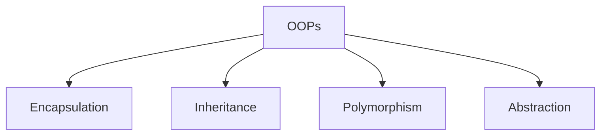

#### Encapsulation

- Bundling fields + methods into a single unit (class).
- Restricting direct access to some components using access modifiers (`private`).
- Providing controlled access through public methods (getters/setters).

**Why?**

To protect data from unauthorized or invalid modifications, and to control how data is accessed and updated.

Example:

```java
class Car {
	
	// private - only be accessed within the class in which they are declared.
    private String color;
    private int speed;

    // Controlled way to update color
    public void setColor(String color) {
        this.color = color;
    }

    // Controlled way to update speed
    public void setSpeed(int speed) {
        if (speed > 0 && speed <= 300) {
            this.speed = speed;
        }
    }

    // Controlled way to access speed
    public int getSpeed() {
        return speed;
    }

    void drive() {
        System.out.println("Car is driving");
    }
}

public class Main {
    public static void main(String[] args) {

        Car audi = new Car();

        audi.setColor("Red");  // Valid update
        audi.setSpeed(200);    // Valid update
        audi.setSpeed(500);    // Rejected (invalid speed)

        System.out.println(audi.getSpeed()); // 200

        audi.drive();
    }
}
```

#### Inheritance (using `extends`)

Allows a class to acquire properties and methods of another class; it supports code reusability.

Example:

```java
// Parent class (Superclass)
class Animal {
    void eat() {
        System.out.println("This animal eats food.");
    }
}

// Child class (Subclass) inherits Animal
class Dog extends Animal {
    void bark() {
        System.out.println("Dog barks.");
    }
}
```

Types:

1. **Single**: One child class inherits from one parent class. (as seen above)
2. **Hierarchical**: side by side.
   Example: another class `Cat extends Animal`
3. **Multilevel**: level by level.
   Example: `Child extends Parents`, `Parents extends Grandparents`. Now Child can also access the Grandparents class.

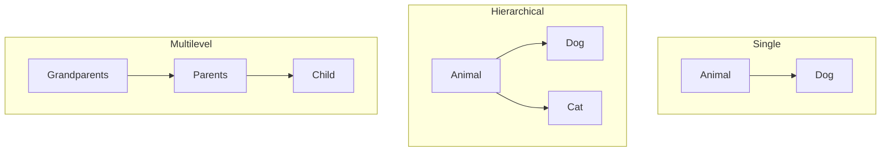

> [!IMPORTANT]
> Java doesn't support multiple inheritance of classes (multiple inheritance of type is possible through interfaces).
> Example: `class C extends A, B` -> is invalid

**Why?**

Suppose both class A and B have the method `turnOn()`.
Then when we do `C.turnOn()` -> which one to run? Confusing...
That's why Java doesn't support this.

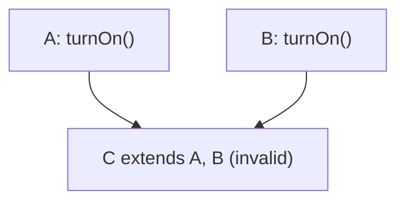

### `super` Keyword

The `super` keyword is used to refer to the immediate parent class object.

It is mainly used for three purposes:

1. When the child class has a variable with the same name as the parent class, use `super` to access the parent's variable.
2. Use `super` to call an overridden method from the parent class.
3. Use `super()` to call the immediate parent class constructor.

Example:

```java
class Animal {
    String name = "Animal";

    // Parent class method
    void sound() {
        System.out.println("Animal makes a sound");
    }

    // Parent class constructor
    Animal() {
        System.out.println("Animal constructor");
    }
}

class Dog extends Animal {
    String name = "Dog";

    Dog() {
        super(); // 3. Calls the immediate parent class constructor
    }

    void display() {
        // 1. Access parent class variable
        System.out.println(super.name); // Animal

        // 2. Call parent class method
        super.sound();
    }
}

public class Main {
    public static void main(String[] args) {
        Dog d = new Dog();
        d.display();
    }
}
```

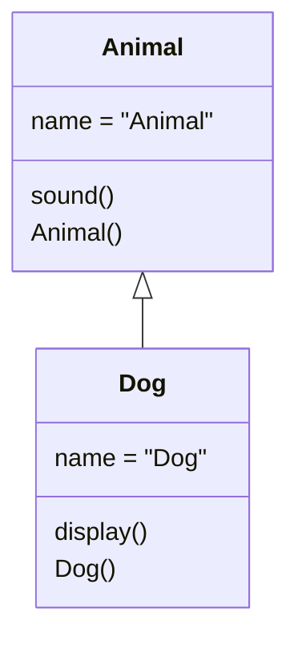

> [!IMPORTANT]
> Remember: `this` refers to the current object, whereas `super` is used to access the immediate parent's members.

> [!NOTE]
> `this()` and `super()` must be the first statement in a constructor.
> A constructor can't call both.

#### Polymorphism

Poly means many, morph means form.
Allows *methods* to perform different tasks, based on the object that calls them.

Can be achieved by:

**1. Runtime polymorphism (method overriding)**

Where a subclass provides its own implementation of a method which is already defined in the parent class. The method to call is determined at runtime, based on the object.

**Why runtime?** Java decides which method to execute at runtime, based on the actual object.

Example:

```java
class Animal {
    void sound() {
        System.out.println("Animal makes sound");
    }
}

class Dog extends Animal {
    @Override
    void sound() {
        System.out.println("Dog barks");
    }
}

Animal a = new Dog(); // a is created using Dog constructor, so it's an instance of dog
a.sound(); // Dog barks (decided at runtime)
```

Note: using `@Override` is optional, but recommended.

> [!IMPORTANT]
> `Dog a = new Animal();`
> Here, a `Dog` reference cannot point to an `Animal` object because every Animal is not necessarily a Dog. It gives a *compilation error*.
>
> But:
> `Animal a = new Dog();` is correct, because every Dog is an Animal (IS-A relationship).
>
> *Remember: Parent reference → Child object is allowed, but Child reference → Parent object is not allowed directly.*

**2. Compile-time polymorphism (method overloading)**

Allows a class to have multiple methods with the same name but *different parameter* lists. The method to execute is determined by the compiler based on the arguments passed.

**Why compile time?** Java decides which method to execute at compile time, based on the arguments passed.

Example:

```java
class Calculator {
    int add(int a, int b) {
        return a + b;
    }
    int add(int a, int b, int c) {
        return a + b + c;
    }
}

Calculator calc = new Calculator();

calc.add(2, 3);       // Calls first method
calc.add(2, 3, 4);    // Calls second method
```

#### Abstraction

Focuses on showing only essential details while hiding the implementation (internal details). It is achieved through abstract classes and interfaces.

**1. Abstract class**

To force child classes to provide their own implementation of a method (acts as a blueprint for subclasses).

Properties:

- Declared using the `abstract` keyword.
- Can include both: abstract methods (methods without a body) and concrete methods (methods with a body).
- Can have constructors, instance variables.
- Can't be instantiated directly.
- Even if a single method is abstract, the whole class needs to be an abstract class.

Example:

```java
abstract class Animal {
    // abstract method (no implementation), child classes must implement this.
    abstract void sound();
    
    // concrete method (common in all subclasses but can also be overridden by any subclass)
    void sleepSound(){
	    System.out.println("zzz...");
	}
}

class Dog extends Animal {
    @Override
    void sound() {
        System.out.println("Dog barks");
    }
}

class Cat extends Animal {
    @Override
    void sound() {
        System.out.println("Cat meows");
    }
}
```

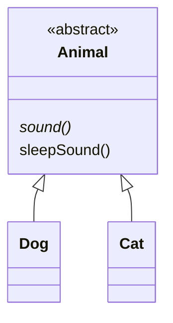

**2. Interface**

Just like a class is a blueprint for objects,
an interface is a blueprint for a class (contract).

Properties:

- Declared using the `interface` keyword.
- A class implements an interface using `implements`.
- It defines methods that implementing classes *must* implement (unless they are default, static, or private methods), i.e., a contract.
- A class can implement multiple interfaces.
- Cannot be instantiated directly.
- Variables declared inside an interface are implicitly `public static final` (constants).
- An interface can extend multiple interfaces.

It can have abstract methods, static constants, static methods and default methods.

```java
interface Vehicle {

    // 1. Abstract method – Without a body; implementing class must define it.
    void start();

    // 2. Static constant – automatically public, static and final.
    int MAX_SPEED = 200;

    // 3. Static method – Belongs to interface; cannot be overridden.
    static void service() {
        System.out.println("Vehicle servicing");
    }

    // 4. Default method – Has a body; can be inherited or overridden.
    default void stop() {
        System.out.println("Vehicle stops");
    }

    // 5. Private method – Used internally by interface methods (Java 9+).
    private void display() {
        System.out.println("Vehicle information");
    }
}

class Car implements Vehicle {

    // Implementing abstract method.
    @Override
    public void start() {
        System.out.println("Car starts");
    }

    // Overriding default method.
    @Override
    public void stop() {
        System.out.println("Car stops");
    }
}

public class Main {
    public static void main(String[] args) {

        Car audi = new Car();

        audi.start();             // Car starts
        audi.stop();              // Car stops (overridden default method)

        System.out.println(Vehicle.MAX_SPEED); // 200 (static constant)

        Vehicle.service();        // Vehicle servicing (static method)

        // audi.display();        // ERROR: private method cannot be accessed.
        // audi.service();        // ERROR: interface static method is not inherited.
    }
}
```

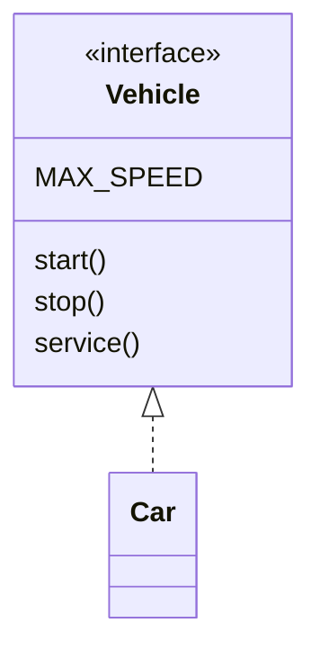

> [!NOTE]
> Remember: interface constants are accessible through implementing classes, but interface static methods are not inherited.

##### Abstract class vs Interface (when to use)

| | Abstract class | Interface |
|---|----------------|-----------|
| Variables | Can have instance variables and static variables. | Implicitly `public static final` (constants). |
| Constructors | Can have constructors. | Cannot have constructors. |
| Methods | Can have abstract and concrete methods. | Can have abstract, default, static and private methods. |
| Inheritance | A class can extend only one class. | A class can implement multiple interfaces. |

##### To resolve conflicts

1. Same abstract method in multiple interfaces -> only one implementation is required.
2. Same default method in multiple interfaces -> must override to resolve the conflict.
3. Abstract method in one interface + default method with the same signature in another -> the class must override the method itself to resolve the conflict. (A default method can satisfy an abstract one only when an interface that extends the other redeclares it as `default`.)

### Access Modifiers

| Modifier | Accessible from |
|----------|-----------------|
| `private` | Within the class only |
| `public` | Everywhere |
| default | Same package (when no modifier is defined) |
| `protected` | Same package + subclass in different packages (through inheritance) |

Example: `Animal` is in the `animals` package, `Dog` is in the `pets` package. But since `Dog` extends `Animal`, it can access `protected` members.

---

## Multithreading Basics

### Core

The CPU executes the program and performs operations (arithmetic, logical operations).
The actual processing is done by CPU cores.
*A core is an individual processing unit inside a CPU.*
Modern CPUs have multiple cores, allowing them to execute multiple tasks in parallel.

`core → process → threads`

- A *process* is a program in execution.
- A process can have *multiple threads*.
- A *thread* is the smallest unit of execution within a process.
- Threads share resources of the same process (memory, files, etc.) but execute independently.

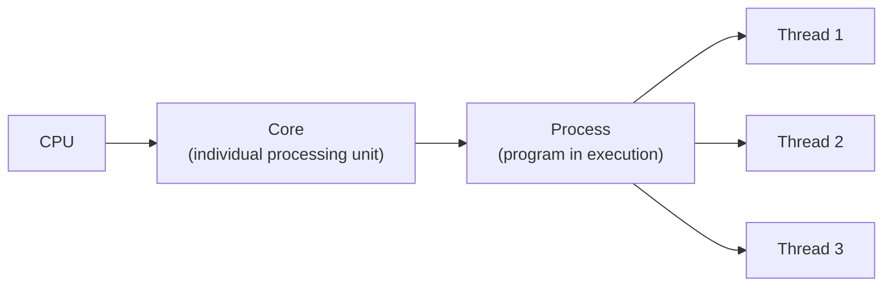

### Single-core vs Multicore

| | Behaviour |
|---|-----------|
| **Single-core CPU** | CPU switches between tasks (context switching) to perform multiple tasks concurrently. |
| **Multicore CPU** | Multiple threads/tasks can execute in parallel using different cores. |

### Multitasking vs Multithreading

- **Multitasking** (at process level) → running multiple processes concurrently. On multicore CPUs, they can execute in parallel.
- **Multithreading** (at thread level) → running multiple threads concurrently within the same process.

Example: a browser uses multithreading to render pages, execute JavaScript, and manage user inputs.

### Multithreading in Java

Java provides robust support for multithreading, allowing developers to create applications that can perform multiple tasks concurrently (which can improve performance and responsiveness).

- In a single-core environment → JVM/OS schedules threads by switching between them to give the illusion of simultaneous execution.
- In a multicore environment → true parallel execution is possible.

Java supports multithreading through:

- `java.lang.Thread` class.
- `java.lang.Runnable` interface.

When a Java program starts, one thread starts running immediately (called the main thread), responsible for executing the `main()` method.

### Important Distinctions

```
// concurrency -> multiple tasks make progress over overlapping periods.
// parallelism -> multiple tasks execute simultaneously on different cores.

// process -> a program in execution.
// thread  -> an execution unit within a process.

// thread scheduling -> primarily handled by the os for java platform threads.
```

Remember:

- Concurrency ≠ parallelism.
- A process can have multiple threads.
- Multiple threads of the same process can run on different CPU cores.

To check the thread name: `println(Thread.currentThread().getName())`

### Creating a New Thread

Two common ways (there are others, like lambdas and `Callable`/`ExecutorService`):

**1. Extend the `Thread` class**

Usage:

```java
// 1. Create a class that extends Thread
class MyThread extends Thread {

    // 2. here we -> Override the run() method
    public void run() {
        System.out.println("Thread is running");
    }
}

class Main {
    public static void main(String[] args) {

        // 3. Create an object of MyThread
        MyThread t = new MyThread();

        // 4. Start the thread (JVM calls run())
        t.start();
    }
}
```

**2. Implement the `Runnable` interface**

Usage:

```java
// 1. Create a class that implements Runnable
class MyTask implements Runnable {

    // 2. here we -> Implement the run() method
    public void run() {
        System.out.println("Thread is running");
    }
}

class Main {
    public static void main(String[] args) {

        // 3. Create an object of MyTask
        MyTask task = new MyTask();

        // 4. Pass the task to a Thread object
        Thread t = new Thread(task);

        // 5. Start the thread
        t.start();
    }
}
```

Key methods:

| Method | Description |
|--------|-------------|
| `start()` | Starts a new thread. |
| `run()` | Contains the task executed by the thread. |
| `join()` | `t.join()` means wait for thread `t` to complete before continuing the current thread. |

### `synchronized` Keyword

Let's understand with an example:

```java
// Observe: Only one Counter object is created.
// Both threads (t1 and t2) access the same Counter object.

Counter c = new Counter();

Thread t1 = new Thread(() -> {
    for (int i = 0; i < 1000; i++)
        c.increment();
});

Thread t2 = new Thread(() -> {
    for (int i = 0; i < 1000; i++)
        c.increment();
});

t1.start();
t2.start();

t1.join();
t2.join();

// Both threads modify the same shared resource.
// This can cause a race condition (lost updates),
// resulting in an inaccurate count.
System.out.println(c.count); // May be less than 2000
```

> [!NOTE]
> `join()` throws `InterruptedException`, so in real code wrap these calls in a `try/catch` or declare `throws InterruptedException` on the method.

Solution? Add the `synchronized` keyword to the class method. Now only one thread at a time can execute a `synchronized` method on the same object. It uses an object's monitor lock. Other threads must wait until the lock is released.

```java
class Counter {
    int count = 0;

    synchronized void increment() {
        count++; // Only one thread can execute this method at a time
    }
}
```

> [!TIP]
> Usage: use the `synchronized` keyword when multiple threads access and modify the same shared resource, and you want to prevent race conditions.

---

## Time

Example:

```java
long start = System.nanoTime(); // OR System.currentTimeMillis()
long end = System.nanoTime();

long time = end - start; // Execution time in nanoseconds

System.out.println("Time: " + time + " ns");
System.out.println("Time: " + (time / 1_000_000.0) + " ms");
```

---

## Try-Catch Block

Use a `try-catch` block to handle exceptions so that the program does not terminate unexpectedly when an error occurs.

Key points:

- `try` must be followed by at least one `catch` or `finally`.
- Only the first matching `catch` block executes.
- `finally` is optional.

Syntax:

```java
try {
    // Code that might throw an exception
}
catch (ExceptionType1 e) {
    // Handles ExceptionType1
}
catch (ExceptionType2 e) {
    // Handles ExceptionType2
}
catch (Exception e) {
    // Handles any other exception not caught above
}
finally {
    // Optional: Executes whether an exception occurs or not
    // Generally used for cleanup operations
}
```

---

## Collection Framework

The Java Collection Framework (JCF) is a set of interfaces and classes used to store, manage, and manipulate groups of objects.

Instead of creating data structures from scratch, we can use built-in classes such as `ArrayList`, `LinkedList`, `HashSet`, and `HashMap`.

<p>
  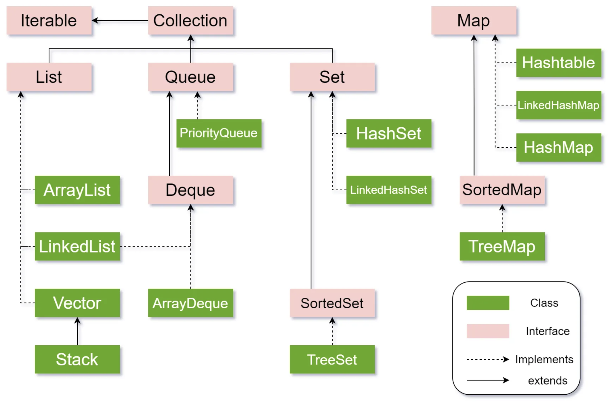
</p>

| Interface | Description |
|-----------|-------------|
| `List` | Ordered collection; allows duplicates |
| `Queue` | Processes elements in a particular order |
| `Set` | Stores unique elements |
| `Map` | Stores key-value pairs; keys are unique |

> [!NOTE]
> `Map` is part of the Collection Framework, but it does not extend the `Collection` interface.

> [!IMPORTANT]
> These classes use *Wrapper* classes, not primitive data types.
>
> **Why?**
> Collections work with objects. Wrapper classes convert primitive values into objects.

Example:

```java
 ArrayList<Integer> numbers = new ArrayList<>(); // not 'int'
```
